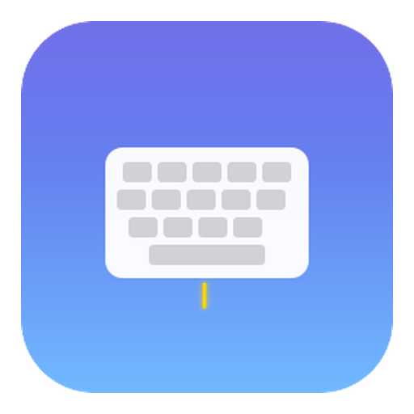

  

<table>
  <tr>
    <td valign="middle">
      
    </td>
    <td valign="middle">
      <strong>Human Typing Simulator v1.0.0 Founder's Edition</strong>
    </td>
  </tr>
</table>

**版本摘要：**  
此为Human Typing Simulator 创始人版 首次发布，版号v1.0.0  
**相较于公测（Beta）版本，更新内容包括：**  
1.新增NatrualType 3.0模型，支持精准纠错  
2.新增hybrid模式，支持输入中混合调用  
3.更新了用户界面，提升了使用体验  
4.解决了一些问题，提升了系统稳定性

**Release Note:**  
This is the first release of Human Typing Simulator Founder's Edition, version v1.0.0.  
**Compared to the Beta version, updates include:**  
1.NatrualType 3.0 model included, precise typo correction is now supported  
2.Hybrid mode added, supporting mixed calling of different model generating models during input  
3.Updated GUI, improving the user experience  
4.Fixed some bugs, improving system stability 

****  
**简介**  
Human Typing Simulator 是一款基于 Python 的自动化输入工具。它通过智能错误生成、动态速率调整和人性化节奏控制，使自动输入的文本看起来完全由真人敲出，而非机械的复制粘贴。无论是绕过行为检测、录制自然教学演示，还是为测试环境注入真实感，本工具都提供了目前最先进的解决方案。  

**Introduction:**  
Human Typing Simulator is a Python-based automated input tool. Through intelligent error generation, dynamic rate adjustment, and human-like rhythm control, it makes automatically typed text appear as if it were typed by a real person, rather than mechanically copied and pasted. Whether it's bypassing behavior detection, recording natural teaching demonstrations, or injecting realism into testing environments, this tool offers state-of-the-art solutions.
